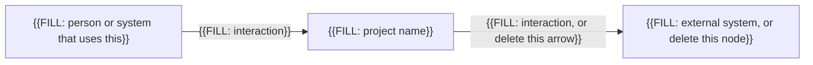
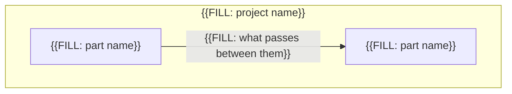

# Architecture

You fill this file in stage 2 (see `README.md`), after `srs.md` has no remaining `{{FILL:` tokens. Replace every `{{FILL: ...}}` token, including the braces.

Do not list prompt filenames here. Do not repeat requirements. When a decision satisfies a requirement, cite its `SRS-FR-` or `SRS-NFR-` ID.

## Required: Context

The C4 context view: the people and external systems around this software. If a node does not exist, delete it.

## Required: Containers

The C4 container view: the main runnable or deployable parts, and how they call each other. Use one node for each part in the list below.

## Required: Parts

Name each major part and its job. The agent must not add a part that is not in this list.

- **{{FILL: part name}}**: {{FILL: responsibility}}
- **{{FILL: part name}}**: {{FILL: responsibility}}

## Required: Stack

Language, runtime, frameworks, and build tool.

{{FILL: stack}}

## Required: Hard constraints

Rules that the agent must not break. Examples: a required library, a required format, work that is forbidden even if an SRS row could permit it.

- {{FILL: hard constraint}}

## Required: Decisions

Record one to three decisions that you already made. Delete the unused decision blocks. The agent must follow these decisions and must not invent a competing architecture.

### Decision 1

- **Context**: {{FILL: the force that required a choice}}
- **Decision**: {{FILL: what you chose}}
- **Rejected**: {{FILL: what you did not choose, and why}}
- **SRS IDs**: {{FILL: IDs this decision serves, or none}}

### Decision 2

- **Context**: {{FILL: the force that required a choice, or delete this decision}}
- **Decision**: {{FILL: what you chose, or delete this decision}}
- **Rejected**: {{FILL: what you did not choose, or delete this decision}}
- **SRS IDs**: {{FILL: IDs this decision serves, or delete this decision}}

### Decision 3

- **Context**: {{FILL: the force that required a choice, or delete this decision}}
- **Decision**: {{FILL: what you chose, or delete this decision}}
- **Rejected**: {{FILL: what you did not choose, or delete this decision}}
- **SRS IDs**: {{FILL: IDs this decision serves, or delete this decision}}

## Required: Primary design rule

During implementation, the agent may read one book rule file. That file biases how the agent writes code inside the boundaries above. It is not a second architecture.

Write one path that ends in `.mini.md`, or write `none`. Do not list two books. Example: `user resources/agent-rules-books/clean-code/clean-code.mini.md`.

Before you select, read `user resources/HOW-TO-agent-rules-books.md` and `user resources/ARCHITECTURE-NOTES.md`.

{{FILL: one mini.md path, or none}}
